<div align="center">

# FindJob

**Мобильное приложение для поиска работы и фриланс-заказов в одной ленте**

Вакансии с hh.ru и Хабр Карьеры, заказы с Kwork и FL.ru, удобные фильтры и пять цветовых тем


</div>

---

## О проекте

FindJob собирает вакансии и заказы с нескольких площадок и показывает их в одном аккуратном интерфейсе. Не нужно открывать четыре сайта: всё в одной ленте, с фильтрами по зарплате, грейду и площадке.

Приложение работает с собственным бэкендом на FastAPI ([find_job_API](https://github.com/LastCoolFish/find_job_API)), который парсит площадки и отдаёт данные через REST API.

## Возможности

- **Лента вакансий** с подгрузкой при прокрутке: карточки грузятся порциями по мере пролистывания
- **Лента заказов** с фриланс-бирж, новые сверху
- **Фильтры** по должности, зарплате, грейду, площадке и сортировка
- **Список площадок приходит с сервера**, поэтому новая площадка появится в фильтрах без обновления приложения
- **Кнопка «Подробнее»** открывает вакансию или заказ прямо на сайте площадки
- **Пять цветовых тем**, переключаются одной строкой в коде
- **Свой стиль загрузки и ошибок**: картинки из символов вместо стандартных крутилок

## Скриншоты

<table>
  <tr>
    <td align="center"><b>Вакансии</b></td>
    <td align="center"><b>Фильтры вакансий</b></td>
    <td align="center"><b>Заказы</b></td>
    <td align="center"><b>Фильтры заказов</b></td>
  </tr>
  <tr>
    <td>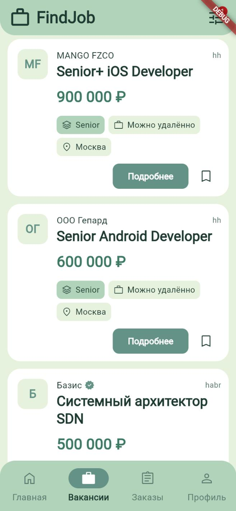</td>
    <td>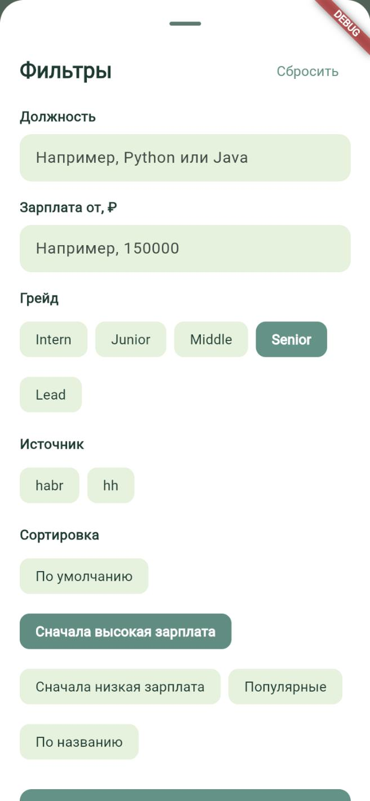</td>
    <td>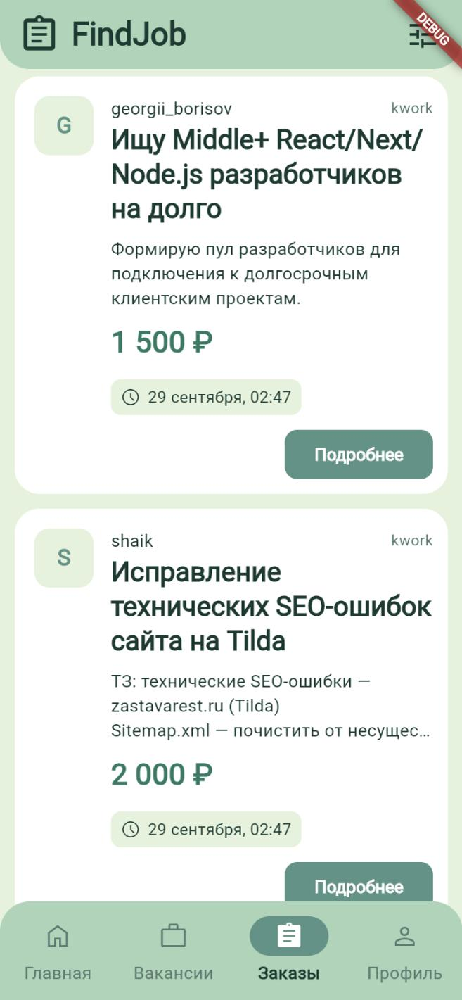</td>
    <td>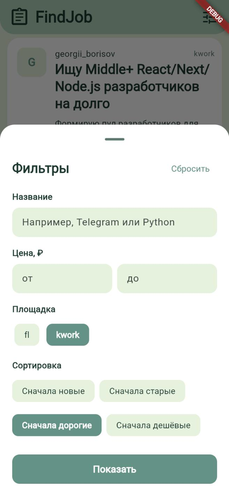</td>
  </tr>
</table>

<table>
  <tr>
    <td align="center"><b>Загрузка</b></td>
    <td align="center"><b>Ошибка</b></td>
  </tr>
  <tr>
    <td>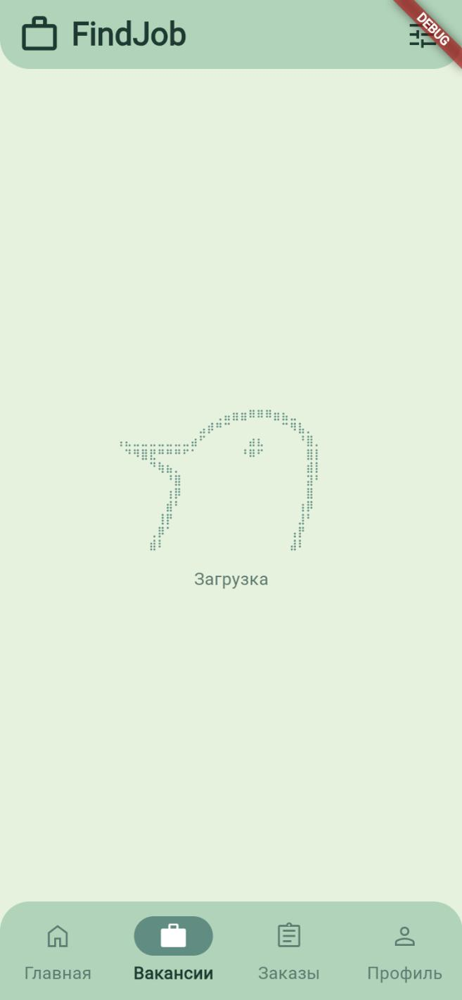</td>
    <td>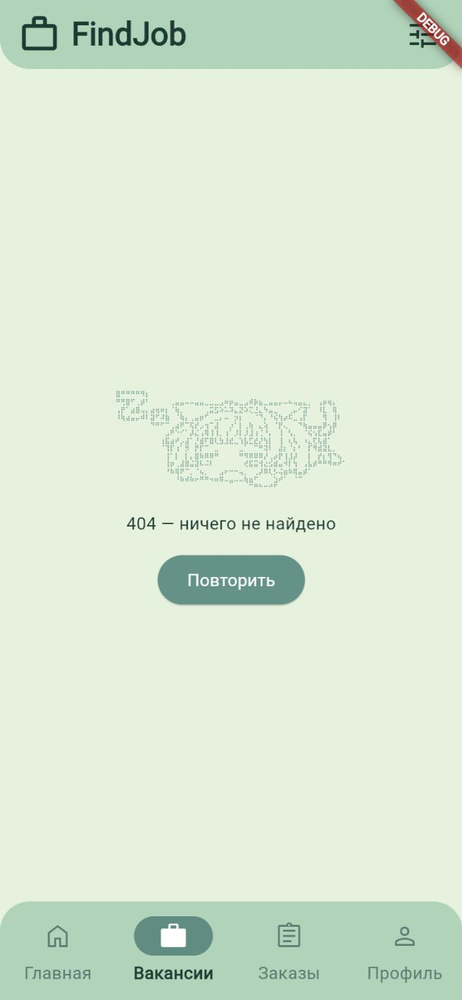</td>
  </tr>
</table>

## Темы оформления

Все цвета вынесены в палитры, поэтому вид приложения меняется целиком, без правок в экранах.

<table>
  <tr>
    <td align="center"><b>Sage</b></td>
    <td align="center"><b>Sunset</b></td>
    <td align="center"><b>Sky</b></td>
    <td align="center"><b>Coffee</b></td>
    <td align="center"><b>Blush</b></td>
  </tr>
  <tr>
    <td>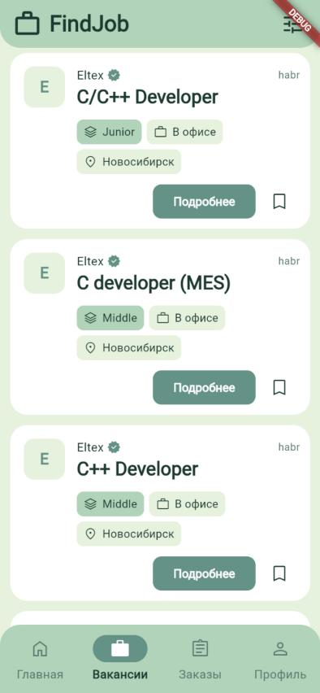</td>
    <td>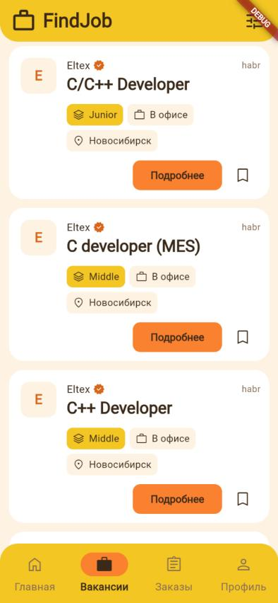</td>
    <td>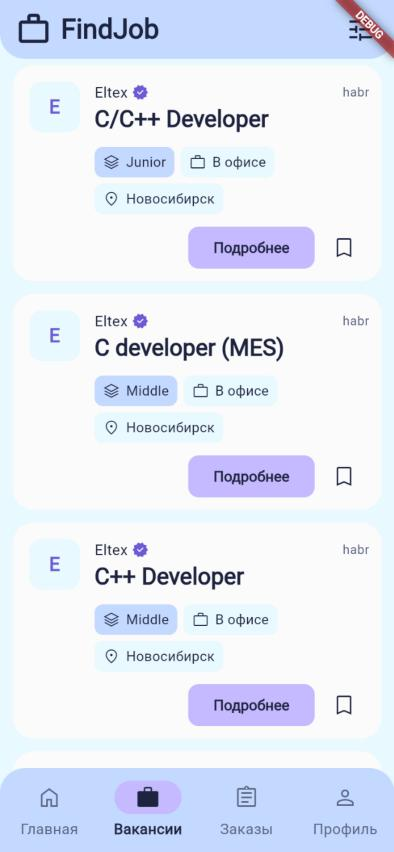</td>
    <td>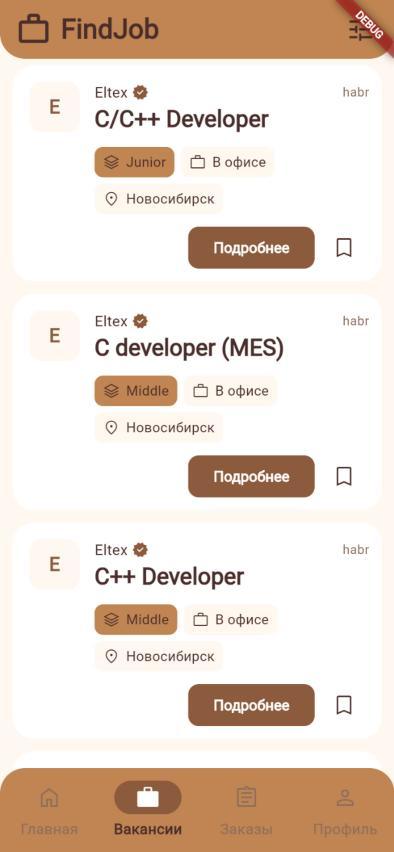</td>
    <td>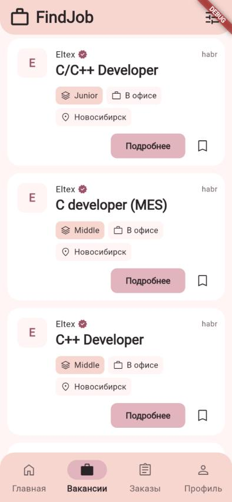</td>
  </tr>
</table>

Тема выбирается в [`lib/core/theme/AppColors.dart`](lib/core/theme/AppColors.dart):

```dart
static const AppPalette palette = AppPalettes.sage; // sunset, sky, coffee, blush
```

## Технологии

| | |
|---|---|
| **Фреймворк** | Flutter, Material 3 |
| **Сеть** | Dio |
| **Внедрение зависимостей** | get_it |
| **Иконки** | Material Symbols |
| **Бэкенд** | FastAPI + PostgreSQL ([find_job_API](https://github.com/LastCoolFish/find_job_API)) |

## Архитектура

Проект разделён по фичам, внутри каждой три слоя в духе Clean Architecture:

```
lib/
├── app/            точка входа и нижняя навигация
├── core/           общее: тема, сеть, виджеты, обработка ошибок
└── features/
    ├── vacancies/  вакансии
    ├── orders/     заказы
    ├── profile/    профиль
    └── ...
        ├── data/          запросы к API и разбор JSON
        ├── domain/        модели и интерфейсы репозиториев
        └── presentation/  экраны и виджеты
```

- Экраны не знают про HTTP: они работают с репозиторием и получают результат в виде `Success` или `Failed`, без исключений
- Пагинация, фильтры и защита от «опоздавших» ответов при быстрой смене фильтров
- Общие виджеты (шапка, карточки, окно фильтров) переиспользуются между вакансиями и заказами

Подробное описание каждого файла лежит в [`lib/README.md`](lib/README.md).

## Запуск

```bash
git clone https://github.com/LastCoolFish/find_job_app.git
cd find_job_app
flutter pub get
flutter run
```

Адрес API задаётся в [`lib/core/config/EnvConfig.dart`](lib/core/config/EnvConfig.dart).

## Что дальше

- Главный экран с подборкой
- Вход в аккаунт и редактирование профиля
- Избранное
- Переключение темы прямо в настройках приложения
